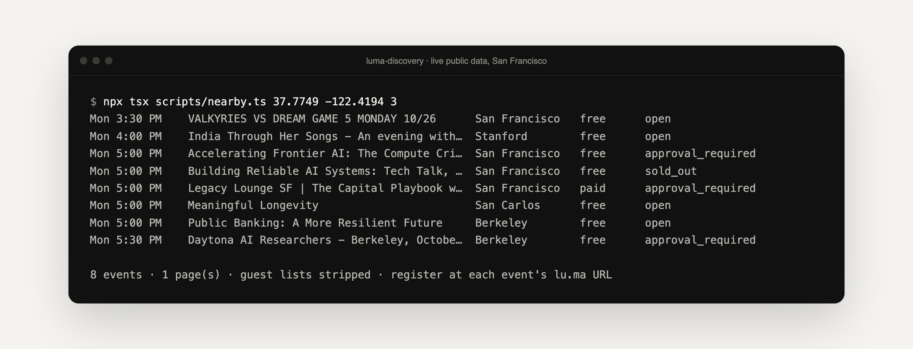

<p align="center">
  <picture>
    <source media="(prefers-color-scheme: dark)" srcset=".github/assets/banner-dark.png">
    
  </picture>
</p>

<p align="center">
  <strong>Find public Luma events from your own code or AI agent.</strong><br>
  A small, read-only TypeScript library and MCP server that returns the events a signed-out visitor on lu.ma can see, in a clean, shared format.
</p>

<p align="center">
  <a href="#quick-start"><strong>Quick start</strong></a> ·
  <a href="#use-it-from-an-ai-agent-mcp"><strong>MCP server</strong></a> ·
  <a href="#the-open-event-record"><strong>Event record</strong></a> ·
  <a href="https://github.com/mihirkavi/structured-event-feeds"><strong>Sibling: structured-event-feeds</strong></a> ·
  <a href="#honest-status"><strong>Status</strong></a>
</p>

<p align="center">
  <a href="LICENSE"></a>
  
  
  <a href="https://github.com/mihirkavi/luma-discovery/actions/workflows/ci.yml"></a>
</p>

<p align="center">
  
  <br><sub>A real run against Luma's public data on 26 October 2026. Titles are public event listings.</sub>
</p>

## Why luma-discovery

Luma hosts a large share of the tech, startup and community events in many cities, but there is no simple way to ask it "what's on near here this week?" from your own backend. Luma's documented API is for organizers managing their own calendars and needs Luma Plus. Assistant-side Luma connectors can't be called from your server.

**luma-discovery does the same public discovery the lu.ma website does for signed-out visitors**, then hands you tidy records: title, time and timezone, venue and coordinates, organizer, price, registration status and an aggregate guest count. People's identities never leave the library.

<table>
  <tr>
    <td width="33%" valign="top">
      <h3>📍 Search by place</h3>
      Events near any latitude and longitude, inside a time window you choose, with paging handled for you. Look up one event by <code>evt-…</code> id, <code>lu.ma</code> URL or slug.
    </td>
    <td width="33%" valign="top">
      <h3>🤖 Built for agents</h3>
      A stdio MCP server with two read-only tools, <code>luma_search_nearby</code> and <code>luma_get_event</code>, for Claude, Codex and any other MCP client.
    </td>
    <td width="33%" valign="top">
      <h3>🔒 Privacy by default</h3>
      No sign-in, no registration, no attendee data. Guest lists, featured guests and their social handles are dropped during normalization. Only the count is kept.
    </td>
  </tr>
</table>

> **Discover here. Register on Luma.** Every result carries the official event URL, so a person signs up there themselves.

## Quick start

Requires Node 22.13+ (or any bundler that compiles TypeScript, such as Wrangler, Vite or esbuild). The package ships TypeScript source.

**Try it in 30 seconds** (no account, no key):

```bash
git clone https://github.com/mihirkavi/luma-discovery && cd luma-discovery
npm install
npx tsx scripts/nearby.ts 37.7749 -122.4194 3   # latitude, longitude, days ahead
```

**Use it as a library:**

```bash
npm install github:mihirkavi/luma-discovery
```

```ts
import { LumaDiscoveryClient } from 'luma-discovery';

const luma = new LumaDiscoveryClient();

const { events } = await luma.searchNearby({
  latitude: 37.3382,
  longitude: -121.8863,
  startsAfter: new Date(),
  startsBefore: new Date(Date.now() + 7 * 86_400_000),
});

const detail = await luma.getEvent(events[0].url); // plain-text description and categories
```

## Use it from an AI agent (MCP)

```bash
npm run mcp   # stdio transport
```

Add it to Claude Code:

```bash
claude mcp add luma-discovery -- npx tsx /path/to/luma-discovery/src/mcp.ts
```

| Tool | What it does |
| --- | --- |
| `luma_search_nearby` | Public events near a latitude/longitude, optionally between `starts_after` and `starts_before`, up to 300 results |
| `luma_get_event` | Public details for one event by `evt-…` id, `lu.ma` URL or slug |

Both tools are annotated read-only. The server tells the model that event text is untrusted data and that it cannot register anyone.

## The open event record

Every result uses the same small, provider-neutral shape as [structured-event-feeds](https://github.com/mihirkavi/structured-event-feeds) (ICS feeds, Meetup, Eventbrite), so you can mix sources or swap adapters without changing your code.

| Field | Example |
| --- | --- |
| `title`, `url`, `provider`, `providerEventId` | `"Meaningful Longevity"`, `https://lu.ma/…`, `"luma"`, `"evt-…"` |
| `startsAt`, `endsAt`, `timezone` | ISO 8601 instants plus the event's IANA zone |
| `venue` | name, address, city, region, country, latitude, longitude |
| `organizer` | the hosting calendar's name and URL, or the listed host names for personal calendars |
| `price` | `isFree`, min/max in cents, currency |
| `registration` | `open` · `sold_out` · `waitlist` · `approval_required` · `closed`, spots remaining, official URL |
| `attendeeCount` | an aggregate number only, never identities |
| `recurrence`, `categories`, `description` | series info; categories and description come from `getEvent` |

The full TypeScript types are in [`src/types.ts`](src/types.ts).

## What it deliberately does not do

- **No registration, sign-in or account actions.** Results link to the official event page.
- **No attendee data.** Only the aggregate guest count survives normalization.
- **No keyword search.** Luma's public discovery is geographic; filter results yourself.

## Honest status

**v0.1.** Verified live on 26 October 2026 with a San Francisco search (the run in the screenshot above), and earlier on 13 October 2026 with Bay Area searches.

- **This is not an official Luma API.** It reads the undocumented `api.lu.ma` JSON endpoints that power Luma's public website. They can change or disappear without notice. Luma's robots.txt does not disallow them.
- Keep request volume modest and cache results. The client sends an identifying user agent and has a 10-second timeout.
- Not published to npm yet; install from GitHub.

<details>
<summary><strong>Development commands and project layout</strong></summary>
<br>

```bash
npm test           # unit tests with recorded-shape fixtures (no network)
npm run typecheck
npm run smoke      # live check against Luma (prints counts and titles only)
npx tsx scripts/nearby.ts [lat] [lng] [days]   # the demo shown above
```

| Path | What it is |
| --- | --- |
| [`src/index.ts`](src/index.ts) | `LumaDiscoveryClient`, normalization and attendee stripping |
| [`src/mcp.ts`](src/mcp.ts) | The stdio MCP server |
| [`src/types.ts`](src/types.ts) | The open event record types |
| [`scripts/`](scripts) | Live smoke check and the `nearby` demo |
| [`test/`](test) | Offline tests with recorded response shapes |

CI runs the typecheck and tests on every push and pull request.

</details>

## Part of Open Media Events

luma-discovery is one of the event sources behind [Open Media Events](https://github.com/mihirkavi/open-media/tree/main/docs/events), and it works perfectly well on its own.

## License

Released under the [MIT License](LICENSE).

<p align="center">
  <br>
  <sub><strong>luma-discovery</strong> · Public events, privately found.</sub>
</p>
